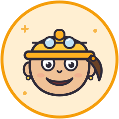

# Department Heads — Cartoon SVG Avatars

A set of 20 fun, cartoon-style SVG head badges — a male and female avatar for
each of 10 company departments. Hand-authored as clean, scalable vector files
(240×240 viewBox).

## Style

Inspired by flat cartoon avatar trends (Open Peeps, Humaaans, memoji/kawaii
icon packs): bold dark outlines (`#2E2A38`), round caps/joins, big expressive
eyes, blush cheeks, pastel badge background + saturated department accent ring,
and a signature prop per department. Skin tones, hairstyles and features vary
across the whole set for a diverse team feel.

## The cast

Each department comes as a pair — same badge colors and signature props, so
they're instantly recognizable as the same team.

| Department | Male (`<dept>.svg`) | Female (`<dept>-female.svg`) |
|---|---|---|
| Engineering | Hard hat, goggles, sideburns | Hard hat, goggles, ponytail |
| Marketing | Backwards cap, starry eyes, megaphone | Cap with ponytail, freckles, megaphone |
| Sales | Slick hair, $ pupils, toothy grin, tie | Auburn bob, $ pupils, hoops, slim tie |
| HR / People | Bob haircut, heart clip | Curly afro, heart clip |
| Finance | Visor, round glasses, mustache | Top bun, visor, round glasses |
| IT Support | Headset with mic, spiky tuft | Headset with mic, long hair + bangs |
| Design | Beret, pencil, wink | Beret, ginger waves, wink, pencil |
| Legal | Silver side-part, spectacles, bow tie | Low bun, spectacles, pearl studs |
| Operations | Bandana, gear, stubble | Bandana, side braid, gear |
| Executive | Slicked silver hair, gold tie | Silver top knot, hoops, pearl necklace |

## Usage

Drop the SVGs into any web page, slide deck, org chart, or intranet:

```html

```

Open `index.html` for a contact sheet of the whole set. Rendered PNG previews
live in `preview/` (regenerate with
`rsvg-convert -w 240 -h 240 name.svg -o preview/name.png`).

## Customizing

Each file is organized with commented sections (`head`, `eyes`, `hair`, …) so
you can easily recolor (swap the ring/bg hex pair), change expressions, or
remix props and hairstyles between characters.
